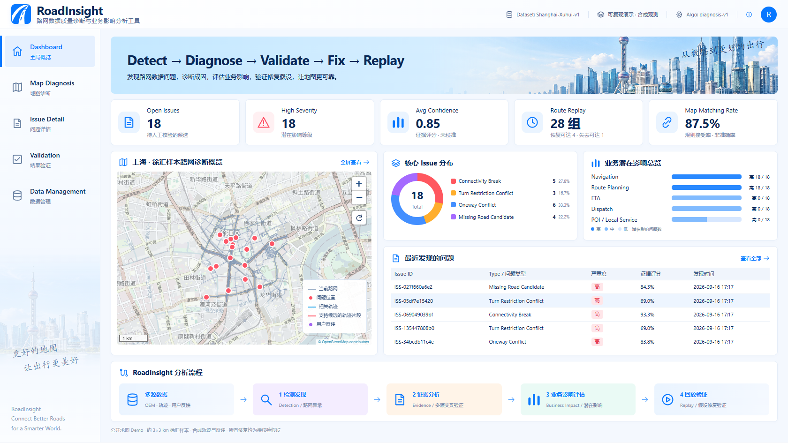
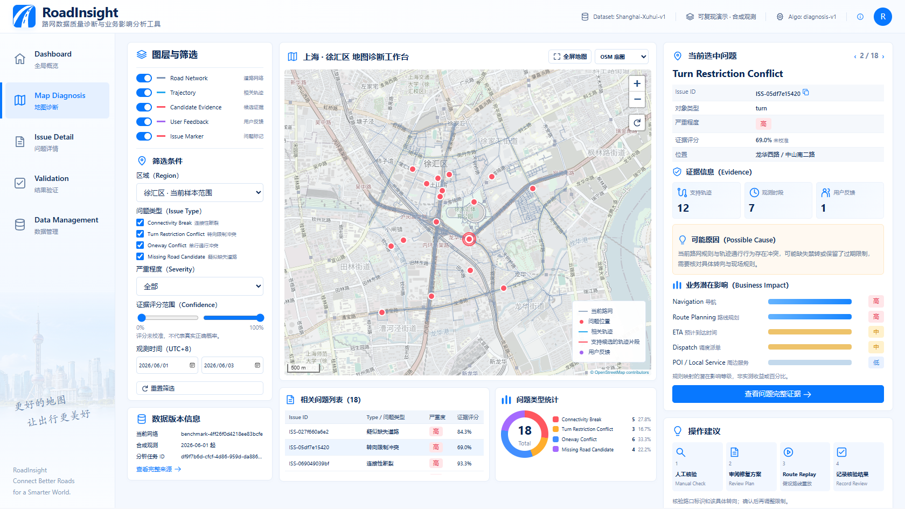
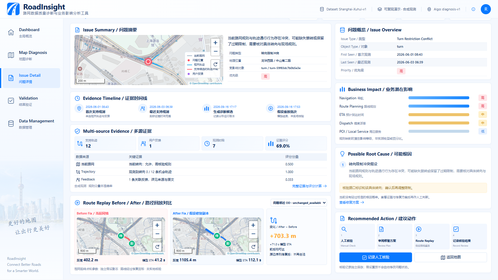
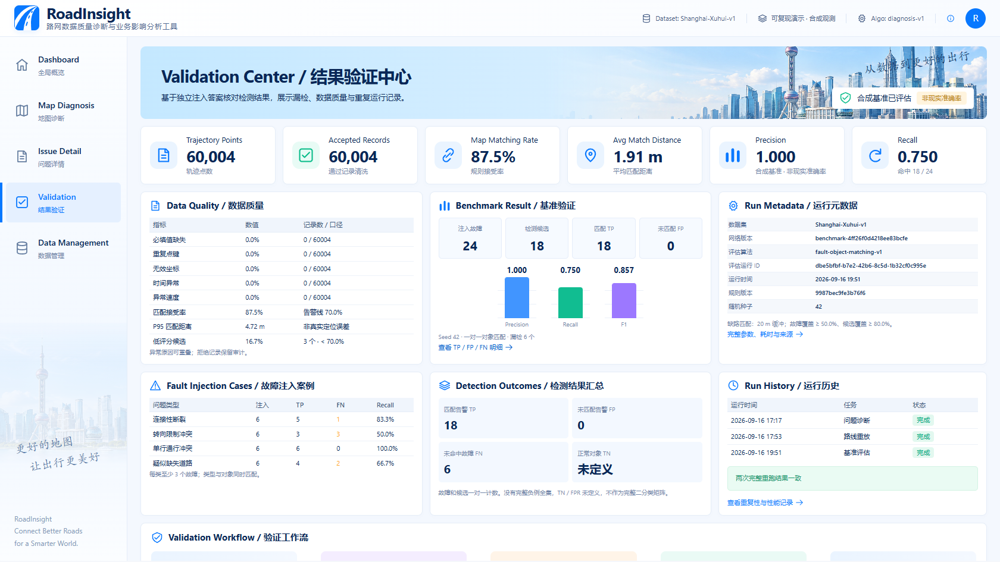
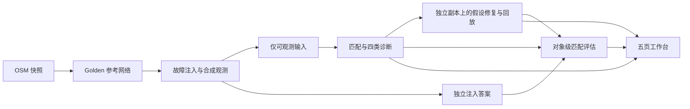

# RoadInsight V2

### 路网数据质量诊断与业务影响分析工具

**Detect → Diagnose → Validate → Fix → Replay**

面向路网数据运营 / 地理位置中台岗位的个人作品集：从 OSM 路网、合成轨迹与反馈识别问题，解释证据与潜在业务影响，在独立副本上验证修复假设，再用已知故障评估检测能力。

[腾讯云公开演示](https://roadinsight-sy-d2g7eacoh8e6c1fae.webapps.tcloudbase.com/) · [打开在线工作台](https://roadinsight-workbench-331907-5-1511207010.sh.run.tcloudbase.com/) · [GitHub Pages 备用演示](https://ashazz315.github.io/roadnet-quality-ops-duckdb/) · [6–8 分钟面试演示](docs/INTERVIEW_DEMO.md) · [验证结果与口径](docs/BENCHMARK_EVALUATION.md) · [部署说明](docs/DEPLOYMENT.md)

> V2 开发与发布位于 `roadinsight-v2` 分支，`main` 保留原版。Streamlit 向访客开放浏览；配置编辑访问码后可上传分析与保存核验。免费平台的上传结果仅临时保存，请及时导出。Pages 提供只读备用演示。项目不代表任何企业内部系统或线上效果。



## 产品解决什么问题

| 问题 | 诊断与证据 | 业务关注点 |
| --- | --- | --- |
| 连通性断裂 | 道路端点、连续穿越轨迹与反馈 | 导航不可达、绕行 |
| 转向限制冲突 | 具体进出路段、当前规则、观测机会与实际转向 | 不合法路线、路口绕行 |
| 单行方向冲突 | 路段方向与重复反向轨迹 | 路径规划与派单风险 |
| 疑似缺失 / 变化道路 | 未匹配走廊与跨时段轨迹 | 可达性与覆盖不足 |

业务影响使用可解释规则映射等级；不把候选数量或假设回放包装成真实收益。人工核验记录独立保存，算法输出不会自动变为“已确认”。

## 五个页面

- **Dashboard**：总览、地图、问题分布、潜在业务影响与分析流程。
- **Map Diagnosis**：图层与筛选、地图 / 列表 / 证据联动。
- **Issue Detail**：问题摘要、证据时间线、根因假设、修复前后路线对比。
- **Validation**：数据质量、独立 Benchmark、漏检明细、重复性与耗时。
- **Data Management**：来源与数据导出；编辑工作区支持 V2 上传分析、历史任务、CSV/XLSX 校验、DuckDB 批次保存、Excel 日报与人工核验记录。

<details>
<summary>查看地图诊断、问题回放与验证中心截图</summary>





</details>

## 当前可复现结果

徐汇约 3×3 km 样本：**1071 条道路、842 个节点、60004 个轨迹点、746 条轨迹、36 条反馈**。路网基于 OSM，故障、轨迹及反馈为受控合成数据。

| 指标 | 当前结果 | 解释 |
| --- | ---: | --- |
| 注入故障 / 检测候选 | 24 / 18 | 四类故障，每类 6 个 |
| TP / FP / FN | 18 / 0 / 6 | 类型 + 对象一对一匹配 |
| Precision / Recall / F1 | 1.000 / 0.750 / 0.857 | 单一 seed 的合成基准，不是现实准确率 |
| TN / FPR | 未定义 | 没有独立负例全集 |
| 地图匹配规则接受率 | 87.55% | 不是有真值支持的匹配准确率 |
| 假设路线重放 | 28 组 | 10 变短、8 变长、5 不变、4 恢复可达、1 失去可达 |
| 完整重复运行 | 2 次一致 | 输入、分析、回放、匹配与规则指纹核对 |

[示例转向候选](https://roadinsight-sy-d2g7eacoh8e6c1fae.webapps.tcloudbase.com/?page=detail&issue=issue-05df7e154203f10da880)：新增禁转假设后，路线从 **402.2 m / 41.2 s** 变为 **1105.4 m / 112.1 s**。原路线不再满足修复后的约束，路线更长仍可能是正确修复的结果；该假设尚未实地核验，ETA 是模型值。

已知不足：转向类召回率 50%；评分未校准；缺路候选仍需人工补充几何与通行条件；未验证现实泛化、大规模并发和线上收益。详见[评估报告](data/validation/default_report.json)。

## 完整服务功能

已增加受编辑访问码保护的工作区：V2 ZIP 数据包上传 → 实际检测与假设回放 → 独立任务保存 → 历史结果切换 → 人工核验；支持持久化目录、重启恢复及手动备份。旧版 CSV/XLSX 入库和 Excel 日报保留。

**腾讯云入口：[公开演示](https://roadinsight-sy-d2g7eacoh8e6c1fae.webapps.tcloudbase.com/) · [Streamlit 工作台](https://roadinsight-workbench-331907-5-1511207010.sh.run.tcloudbase.com/)。** [腾讯云部署与编辑访问码配置](docs/CLOUDBASE.md)说明访客浏览、编辑解锁及临时存储边界。免费平台可能休眠，上传结果不能作为长期备份；需要持久卷和备份时参见 [完整服务说明](docs/FULL_SERVICE.md)。

## 本地运行

使用 Python 3.12，在仓库根目录运行。仓库附带校验后的演示快照，首次启动不需要下载地图或重跑检测。

```sh
git clone --branch roadinsight-v2 --single-branch https://github.com/ashazz315/roadnet-quality-ops-duckdb.git
cd roadnet-quality-ops-duckdb
python -m venv .venv
```

Windows PowerShell 激活：`.\.venv\Scripts\Activate.ps1`；macOS / Linux：`source .venv/bin/activate`。

```sh
python -m pip install -r requirements.txt
python -m streamlit run roadinsight_app.py --server.address 127.0.0.1
```

浏览器打开 `http://127.0.0.1:8501/`。Windows 也可使用 `run_roadinsight.bat`。原版仍可通过 `python -m streamlit run app.py` 启动，详见[旧版工作台说明](docs/LEGACY_WORKBENCH.md)。

## 复现与测试

```sh
python -m pip install -r requirements-dev.txt
python -m pytest -q
python scripts/09_validate.py --output data/runtime/validation_demo
```

最后一条命令从固定 Golden 重建两轮故障数据、检测、假设回放和独立评估，产出报告、指纹与阶段日志；输出目录必须不存在。Node 22 可选，用于前端模型测试：`node --test tests/ui_model.test.cjs`。

只读站点可独立导出与本地预览：

```sh
python scripts/10_build_public_demo.py --output data/runtime/public_demo
python -m http.server 8510 --bind 127.0.0.1 --directory data/runtime/public_demo
```

GitHub CI 执行 Python / 前端测试、两轮完整复现与公开页面验收；通过后才部署 V2 分支的 Pages 演示。

## 架构与数据边界



检测模块不能读取注入答案；评估在检测完成后独立运行。使用 Python、DuckDB、GeoPandas、Shapely、NetworkX、Streamlit 与本地 Leaflet 组件。网页地图与回放直接展示已有分析产物，不在浏览器重新生成结论。

| 目录 / 文档 | 内容 |
| --- | --- |
| `src/` | 路网、Benchmark、诊断、回放与评估模块 |
| `roadinsight_app.py` / `roadinsight_ui/` | V2 入口、交互界面与公开导出 |
| `data/demo/` / `data/validation/` | 经过校验的页面快照与独立评估 |
| `scripts/04_*.py` 至 `scripts/10_*.py` | 各阶段流水线、验证和公开演示构建 |
| [产品规格](docs/PRODUCT_SPEC.md) / [数据模型](docs/DATA_MODEL.md) | 产品方向、数据实体与字段 |
| [诊断设计](docs/ISSUE_ANALYSIS.md) / [回放设计](docs/ROUTE_REPLAY.md) | 证据评分、候选生成与假设验证 |
| [模块边界](docs/MODULE_BOUNDARIES.md) / [页面指南](docs/UI_GUIDE.md) | 数据隔离与使用说明 |

## 数据与素材说明

© OpenStreetMap contributors，底层 OSM 数据按 ODbL 署名；在线底图为可选位置参照，离线路网仍可展示。Leaflet 许可证随组件附带。城市装饰不参与分析。参见[来源与许可说明](docs/ATTRIBUTION.md)。
